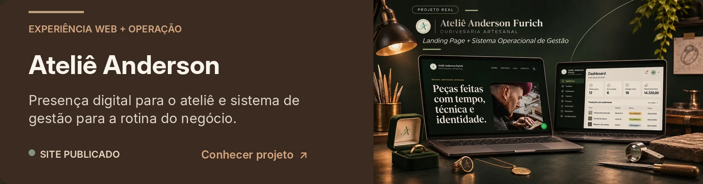
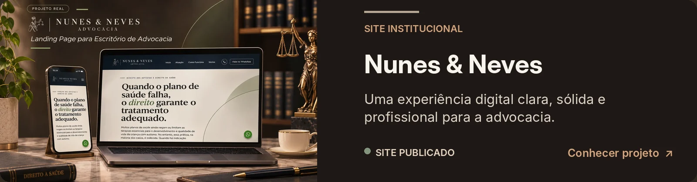
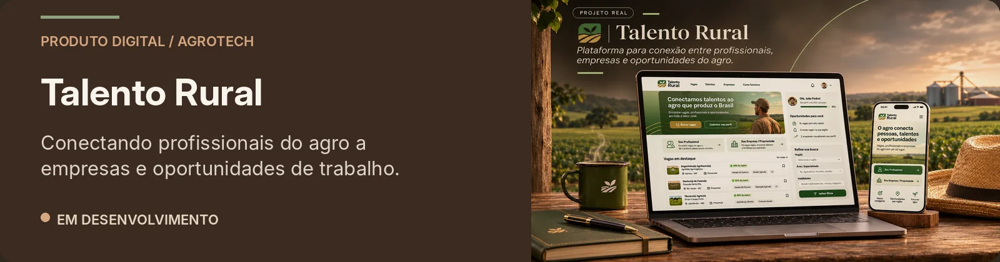
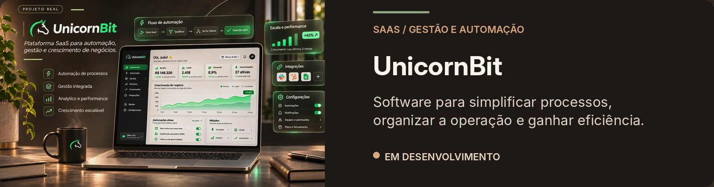

<h3>Software, dados e produtos que fazem sentido para o negócio.</h3>

<picture>
  <source media="(prefers-color-scheme: dark)" srcset="https://readme-typing-svg.demolab.com/?font=Fira+Code&amp;weight=500&amp;size=18&amp;duration=3300&amp;pause=1250&amp;color=BA8B62&amp;center=true&amp;vCenter=true&amp;width=950&amp;height=56&amp;lines=Da+matem%C3%A1tica+ao+c%C3%B3digo.+Do+c%C3%B3digo+ao+produto.%3BSolu%C3%A7%C3%B5es+digitais+com+vis%C3%A3o+de+neg%C3%B3cio.%3BSoftware%2C+dados+e+automa%C3%A7%C3%A3o+com+prop%C3%B3sito.%3BE+sempre+um+caf%C3%A9+forte+por+perto.+%E2%98%95" />
  <source media="(prefers-color-scheme: light)" srcset="https://readme-typing-svg.demolab.com/?font=Fira+Code&amp;weight=500&amp;size=18&amp;duration=3300&amp;pause=1250&amp;color=65412F&amp;center=true&amp;vCenter=true&amp;width=950&amp;height=56&amp;lines=Da+matem%C3%A1tica+ao+c%C3%B3digo.+Do+c%C3%B3digo+ao+produto.%3BSolu%C3%A7%C3%B5es+digitais+com+vis%C3%A3o+de+neg%C3%B3cio.%3BSoftware%2C+dados+e+automa%C3%A7%C3%A3o+com+prop%C3%B3sito.%3BE+sempre+um+caf%C3%A9+forte+por+perto.+%E2%98%95" />
  
</picture>

<a href="#sobre">Sobre</a> &nbsp;·&nbsp; <a href="#como-posso-contribuir">Atuação</a> &nbsp;·&nbsp; <a href="#projetos-selecionados">Projetos</a> &nbsp;·&nbsp; <a href="#vamos-conversar">Contato</a>

---

## O que me move não é o código. É o que ele torna possível.

Olá! Eu sou **João Pedro F. Winter Jr.** 👋

Minha trajetória começou pela **Matemática**, onde aprendi a dar estrutura a problemas complexos. Os **dados** me mostraram como transformar informação em decisões. E, no **desenvolvimento de software**, encontrei uma forma de transformar essas decisões em ferramentas que as pessoas realmente usam.

Hoje trabalho na interseção entre **software, dados, produtos digitais e negócios**. Na **V8 Digital**, aprofundo essa visão no setor financeiro; no **Sicredi Liberdade**, trabalhei com estratégia, processos e BI; e, na **ProbY Global**, vivi o ambiente de uma startup de tecnologia. São experiências diferentes, mas com a mesma exigência: entender o contexto, fazer escolhas técnicas e entregar algo útil.

> **Antes de construir, eu procuro entender.** A melhor solução nem sempre é a mais complexa — é a que se encaixa no negócio e simplifica a vida de quem usa.

Sou **bacharel em Matemática**, estudante de **Análise e Desenvolvimento de Sistemas** e pós-graduando em **Análise de Dados**.

---

## Onde eu entro em um projeto

Posso assumir uma entrega específica ou integrar uma equipe técnica por demanda. Não trabalho apenas com a implementação: também ajudo a transformar necessidades em um escopo claro.

**Desenvolvimento web & sistemas**  
Sites institucionais, landing pages, aplicações web, sistemas internos e MVPs.

**Dados & BI**  
Dashboards, indicadores, análises, SQL, Python e informações que apoiam decisões.

**Automações & integrações**  
APIs, fluxos entre sistemas, tratamento de dados e aplicação prática de IA onde ela gera valor.

**Produtos digitais**  
Da exploração da oportunidade à evolução do produto, conectando experiência de uso, viabilidade e execução técnica.

 

FERRAMENTAS QUE USO NA PRÁTICA

<h4>Dados & BI</h4>

  
  
  
  
  
  

<h4>Desenvolvimento Web</h4>

  
  
  
  
  

<h4>Bancos de Dados</h4>

  
  
  

<h4>Inteligência Artificial</h4>

  
  
  
  
  
  

<h4>Automação</h4>

  
  
  

<h4>Outras ferramentas de apoio</h4>

  
  
  
  
  

---

## Projetos selecionados

Uma seleção do que construo: de experiências web a produtos digitais completos. **Clique nos cards dos projetos publicados para acessar os sites.**

<a href="https://copaagronomia.netlify.app/" title="Conhecer Copa Agronômica">
<picture>
  <source media="(max-width: 640px)" srcset="assets/readme/projects/copa-agronomica-mobile.webp" />
  
</picture>
</a>

<a href="https://ourivesanderson.netlify.app/" title="Conhecer Ateliê Anderson">
<picture>
  <source media="(max-width: 640px)" srcset="assets/readme/projects/atelie-anderson-mobile.webp" />
  
</picture>
</a>

<a href="https://nunesnevesadvocacia.com.br/" title="Conhecer Nunes & Neves">
<picture>
  <source media="(max-width: 640px)" srcset="assets/readme/projects/nunes-neves-mobile.webp" />
  
</picture>
</a>

<picture>
  <source media="(max-width: 640px)" srcset="assets/readme/projects/talento-rural-mobile.webp" />
  
</picture>

<picture>
  <source media="(max-width: 640px)" srcset="assets/readme/projects/unicornbit-mobile.webp" />
  
</picture>

Os projetos em desenvolvimento são iniciativas em construção; seus produtos ainda não possuem páginas públicas.

---

## A tecnologia pode ser séria. A conversa não precisa. ☕

Gosto de discutir arquitetura, dados, produtos e boas ideias — especialmente quando a conversa começa com uma pergunta interessante e um **café forte**.

**Código, dados e um bom café. ☕**

---

## Tem um desafio técnico ou uma ideia de produto?

Trabalho com **empresas, startups e agências**, no Brasil e fora, em entregas independentes e parcerias de desenvolvimento. Se o projeto exige alguém que entenda o negócio e também construa a solução, temos assunto.

[**GitHub**](https://github.com/JPWinterFrankJr) &nbsp;·&nbsp; [**Projetos**](https://github.com/JPWinterFrankJr?tab=repositories) &nbsp;·&nbsp; [**Copa Agronômica**](https://copaagronomia.netlify.app/)

Desenvolvimento, dados e uma boa dose de curiosidade.

